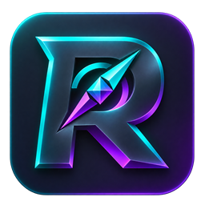

# RezaxFinder

Ton compagnon Fortnite pour Windows, version **3.4.1**, **créé par rezaxuhq**.

[Télécharger la dernière version](https://github.com/zzax62/RezaxFinder/releases/latest)

Installe `RezaxFinder-Setup-x.x.x.exe` une première fois. Les prochaines mises à jour arrivent dans l’application : **Mises à jour → Télécharger → Redémarrer et mettre à jour**.

La version 3.4.0 ajoute **12 thèmes sombres et clairs** et un éditeur pour créer jusqu’à **24 thèmes personnels**. Choisis les couleurs du fond, des panneaux, du menu, des accents et des boutons, avec un aperçu immédiat avant d’enregistrer. Retrouve-les dans **Préférences → Réglages → Affichage**. Le thème Classique garde l’apparence précédente et le menu simplifié reste en place. Les coffres cassés restent inclus une seule fois dans le total.

## Ton univers Fortnite

- **Profil sans mot de passe** : pseudo et plateforme, mémorisés localement. Ce profil ne connecte pas ton compte Epic Games.
- **Statistiques** : carrière/saison, modes et commandes, victoires, K/D, éliminations, matchs, comparaisons et favoris. Données publiques uniquement.
- **Boutique** : articles et packs du jour, prix en V-Bucks, recherche et filtres. Consultation uniquement.
- **Actualités** : Battle Royale, Sauver le monde et Créatif selon les flux disponibles.
- **Collection** : nouveautés et catalogue des cosmétiques, musiques, instruments, voitures et créations LEGO.
- **Explorer** : modes de jeu, bannières, couleurs, carte actuelle, codes créateurs et données publiques avancées.
- **Ctrl+K** : recherche rapide dans les pages de l’application.
- **Treasure Hours** : horaires locaux des créneaux confirmés par Epic, annonce officielle et rappel au début ou 5, 15, 30 ou 60 minutes avant. RezaxFinder doit rester ouvert, même réduit ; les notifications Windows dépendent des réglages du système.
- **Historique** : anciennes versions, nouveautés et corrections, avec sélection d’une version et copie disponible hors connexion.
- **Classement** : participation facultative depuis le choix du pseudo ou le menu Classement, top 100 et position personnelle. Le pseudo, la plateforme, le total de coffres et le nombre de parties comptées deviennent publics. Les fichiers de replay restent sur ton PC. Quitter retire le profil public ; hors ligne, le partage s’arrête immédiatement et le retrait est réessayé au retour de la connexion.

Le classement est communautaire et n’authentifie pas le compte Epic. La participation est liée à cette installation : un autre PC peut créer une autre entrée. Les totaux proviennent du compteur de replays de RezaxFinder, pas des statistiques Fortnite-API. Un changement de profil dans Compteur suspend le partage jusqu’au retour sur le profil associé.

L’accès aux statistiques passe par le [service partagé RezaxFinder](https://rezaxfinder-stats.cleanoak32.chatgpt.site/). Aucune clé privée n’est distribuée dans l’installateur. Les recherches utilisent un quota commun et les résultats peuvent être mis en cache quelques minutes. Un profil Fortnite privé ne peut pas être consulté.

## En partie

La carte 43.10 contient 1 029 emplacements possibles : 921 coffres classiques, 39 rares et 69 enterrés. Le HUD conserve uniquement la carte, les coffres et le trajet.

- Circuits favoris et zones de recherche personnalisées.
- Profils de HUD, zoom automatique facultatif et options visuelles.
- Compteur de replays : total, session, dernière partie et trésors.
- Validation manuelle des coffres et raccourcis personnalisables.
- Approche individuelle d’un coffre et relance après reconnaissance du bouton Rejouer.

Choisis ton écran, calibre la mini-carte, puis démarre le suivi. Fortnite doit rester au premier plan. **Échap** arrête l’approche ; **F9** ouvre l’application.

Active l’enregistrement des replays dans Fortnite pour le compteur. Ses résultats restent distincts des statistiques publiques et des validations sur la carte.

Les réglages, le calibrage et le compteur des replays sont conservés dans `%LOCALAPPDATA%\RezaxFinder`. Le profil d’accueil et les favoris de joueurs sont enregistrés dans le profil local de l’application. Les données en ligne et les images sont chargées à la demande ; aucune capture du suivi n’est envoyée.

Ce dépôt contient les versions distribuées et leur documentation. Les sources et licences du lecteur autonome de replays adapté du projet de LED-N accompagnent l’installation.

Données en ligne : Fortnite-API. Emplacements 43.10 : Burnaviour ; fond de carte : Fortnite-API. Non affilié à Epic Games.
